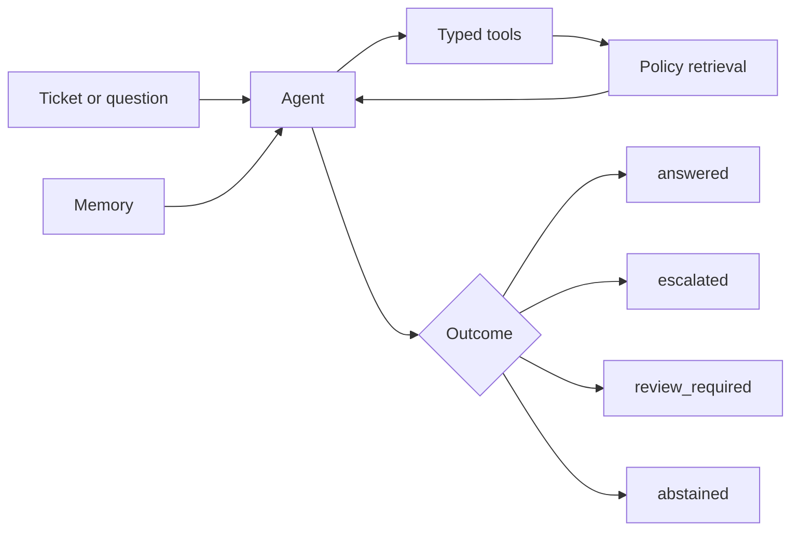

# Northstar Operations Assistant

A local-first support operations agent. It reads ticket and customer context through typed tools, retrieves approved policies before giving guidance, remembers follow-up context, and drafts the next action: a ticket update, an escalation, or a refusal to guess.

It never sends messages or changes real systems. Every action is a draft for a human to review.

## Why this project

Support teams need fast help with account access, refunds, privacy requests, and incidents. An assistant that invents policy is worse than none. This project shows how to build one that:

- cites approved sources and rejects any citation it did not retrieve,
- abstains when the policies do not answer the question,
- hands off to a human when it cannot finish safely,
- treats text inside tickets and documents as data, never as instructions,
- exposes a full trace of every tool call for review.

## How it works



| Part | What it does |
|---|---|
| Data validation | Checks tickets, customers, policies, memory, and evaluation cases before anything runs. |
| Typed tools | Ticket lookup, customer context, policy search, on-call availability, ticket update draft, escalation draft. Each call is traced. |
| Retrieval | Splits policies into chunks that keep their source ID, scores them with TF-IDF cosine similarity, and applies a minimum score. |
| Citations | Answers cite source IDs such as `[refunds]`. A citation that is not in the accepted evidence is rejected. |
| Memory | Short-term turns plus case memory per conversation. It resolves references like "the same customer" and is never shared across customers. |
| Budgets | Maximum agent steps and tool calls. When a limit is hit, the result is `review_required`. |
| Safety | Instruction-like text in tickets or retrieved documents is removed and logged as a safety event. |
| Evaluation | Scores task completion, tool correctness, retrieval grounding, memory use, and failure recovery. |

## Project structure

```text
data/
  knowledge_base/   approved policies, each with a stable source ID
  operations/       tickets, customers, on-call availability, seed memory
  evaluation/       labeled evaluation cases
src/
  models.py         typed data contracts
  data_validation.py
  tools.py          tools, trace, tool-call budget
  retrieval.py      chunking, scoring, citation validation
  memory.py         short-term and case memory
  agent.py          control flow, routing, step budget
  evaluation.py     metrics and report generation
  cli.py            command line interface
tests/              unit and behavior tests
reports/            generated evaluation report
```

## Quick start

Requires Python 3.13 and [uv](https://docs.astral.sh/uv/).

```bash
uv sync
cp .env.example .env
uv run python -m src.cli validate
uv run pytest
```

## Usage

```bash
# Work a ticket: tool trace, citations, and a draft
uv run python -m src.cli run --ticket T-1001

# Escalate an incident using on-call availability
uv run python -m src.cli run --ticket T-1003

# Unsupported request: the agent abstains
uv run python -m src.cli run --ticket T-1005

# Two turns; the second resolves the ticket from memory
uv run python -m src.cli followup

# Ask a free question about the policies
uv run python -m src.cli ask "Can I get a refund for a duplicate payment?"

# Score every case and write reports/evaluation_report.md
uv run python -m src.cli evaluate
```

Settings live in `.env`: `TOP_K`, `MIN_SCORE`, `MAX_AGENT_STEPS`, `MAX_TOOL_CALLS`.

## Results

On the seven labeled cases the agent passes every metric: task completion, tool correctness, retrieval grounding, memory use, and failure recovery. The full per-case table, retrieval-threshold evidence, and failure analysis are in [reports/evaluation_report.md](reports/evaluation_report.md).

Seven cases is a small sample, so read these results as a prototype check, not a production guarantee.

## Design decisions and limitations

- The agent is deterministic and rule-based. It uses no language model, so runs are reproducible and need no API key.
- Escalation is chosen from the ticket category and the customer `verified` flag, not from the retrieved policy text. Routing from evidence is the first planned improvement.
- Retrieval is lexical. A supported ticket that scores close to the threshold could flip to an abstention after a small wording change.
- Memory lives in process and is lost after each run.

## Roadmap

1. Route escalations from retrieved policy text.
2. Add semantic embeddings next to lexical search.
3. Persist memory and the trace in an access-controlled store.
4. Add a provider-backed language model with injection tests, behind the same tool contracts.

## Design questions

**Which tool failures would be most harmful?**

- `get_customer_context` returning the wrong customer: a draft would use another person's data.
- `check_availability` reporting an unavailable owner as available: an escalation would go to nobody.
- `search_policy` returning a weak match as evidence: the agent would cite a policy that does not apply.
- A draft tool that sent real messages instead of creating drafts. These tools only create drafts.

**How was the retrieval threshold selected?**

The report sweeps thresholds against all seven cases. The lowest score of a supported case is 0.2139 and the highest score of an unsupported case is 0.0796. Any threshold between them decides every case correctly, and the default 0.18 is inside that range. Only seven cases exist, so this is weak evidence.

**What shows that memory helped and did not pollute?**

- In the follow-up case the agent resolved ticket `T-1002` from memory without a ticket ID.
- A test shows that memory belonging to another customer is not used, and notes never carry over between customers.
- Memory only selects the ticket. It never feeds retrieval or overrides policy. There is no evidence that it improves answer quality beyond resolving references.

**When should the agent hand off to a human?**

- The responsible queue has no available owner.
- The ticket needs identity review, finance approval, privacy processing, or incident response.
- A tool fails, a citation is not in the accepted evidence, or a step or tool-call limit is reached.
- Memory belongs to a different customer than the current ticket.
- No policy evidence passes the threshold. The agent abstains and drafts nothing.

**What would change before connecting to real systems?**

- Authentication and permissions for every tool, and access control on stored memory.
- A persistent audit log of the trace, and memory stored outside the process.
- Escalation routing from retrieved policy text instead of ticket category.
- Semantic retrieval and many more evaluation cases, including live-model injection tests.
- Human approval before any draft is sent, and a privacy review for personal data.

## License

MIT. See [LICENSE](LICENSE).
